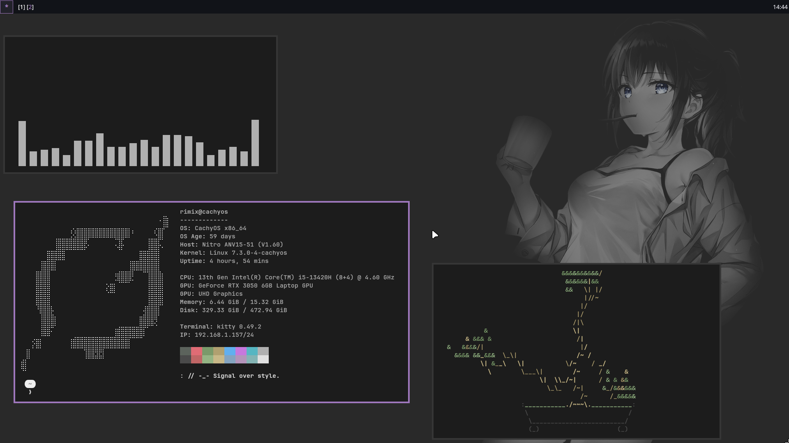

# dots

Минималистичный чёрно-серый райс на **Hyprland** с одним акцентным цветом — пурпурным `#9f78bd`.
Интерфейс серый, а всё, что рисует содержимое (иконки, подсветка в терминале, картинки), остаётся цветным.



## Что внутри

| Папка | Что настраивает |
|---|---|
| `hypr` | Hyprland (Lua-конфиг, разбит на модули), hyprpaper, hyprlock, hypridle |
| `kitty` | терминал: шрифт, цвета, шлейф курсора |
| `fuzzel` | лаунчер |
| `quickshell` | `shell.qml` |
| `qt` | `kdeglobals` и qt6ct: цвета Qt-приложений |
| `fastfetch` | конфиг и логотип |
| `starship` | промпт |
| `swaync` | центр уведомлений: конфиг и стиль |
| `swayosd` | экранные индикаторы громкости/яркости: конфиг и стиль |
| `system` | файлы вне `~`: `etc/ly/config.ini` для экрана входа ly |
| `nvim` | редактор |

Конфиг Hyprland написан на Lua (формат Hyprland 0.55+) и разбит на файлы:
`hyprland.lua` подключает `appearance`, `input`, `binds`, `rules` и `autostart`.

## Палитра

| Роль | Цвет |
|---|---|
| фон | `#1c1c1c` |
| неактивная рамка | `#333333` |
| текст | `#d0d0d0` |
| акцент (активная рамка, выделение, курсор) | `#9f78bd` |

Шрифт везде один: JetBrainsMono Nerd Font. Курсор: Bibata-Modern-Ice. Иконки: Papirus-Dark.

## Основные бинды

| Клавиши | Действие |
|---|---|
| `SUPER + Q` | терминал (kitty) |
| `SUPER + R` | лаунчер (fuzzel) |
| `SUPER + C` | закрыть окно |
| `SUPER + V` | плавающее окно вкл/выкл |
| `SUPER + J` | сменить направление разделения |
| `SUPER + F` | полный экран |
| `SUPER + D` | развернуть на всё окно (с рамками и отступами) |
| `SUPER + L` | заблокировать экран (hyprlock) |
| `SUPER + 1…0` | рабочий стол |
| `SUPER + SHIFT + 1…0` | перенести окно на рабочий стол |
| `Print` | скриншот области в буфер обмена |

## Зависимости

Arch Linux (названия пакетов могут отличаться в других дистрибутивах):

```
hyprland hyprpaper hyprlock hypridle kitty fuzzel fastfetch starship quickshell swaync swayosd
stow grim slurp hyprshot wl-clipboard cliphist brightnessctl playerctl
plasma-integration qt6ct
ttf-jetbrains-mono-nerd papirus-icon-theme bibata-cursor-theme
```

Экран входа: `ly` (по желанию).

## Установка

```
git clone https://github.com/Rimix98/dots ~/dots
cd ~/dots
```

Если в `~/.config` уже лежат одноимённые файлы, `stow` откажется их заменять: сначала сделай копию или удали их.

```
stow hypr kitty fuzzel quickshell qt fastfetch starship swaync swayosd
```

В конфигах, где указан абсолютный путь (обои и схема Qt), стоит заглушка `/home/USER`.
Подставь свой домашний каталог:

```
sed -i "s|/home/USER|$HOME|g" ~/.config/hypr/hyprpaper.conf ~/.config/hypr/hyprlock.conf ~/.config/qt6ct/qt6ct.conf ~/.config/swayosd/config.toml
```

Положи обои в `~/Pictures/Wallpapers/wallhaven-1kld7w.png` (или поправь путь в `hyprpaper.conf` и `hyprlock.conf`).

Экран входа ly (по желанию):

```
sudo cp system/etc/ly/config.ini /etc/ly/config.ini
```

## Заметки

- Qt-приложения берут цвета из `~/.config/kdeglobals` через плагин `kde`
  (`QT_QPA_PLATFORMTHEME=kde`), а не через qt6ct.
- В `autostart.lua` лежит запуск hyprpaper и `wl-paste --watch cliphist store`:
  уберите или замените под себя.
- Перед тем как применять конфиги на рабочей системе, лучше сохранить свои.

## Обои

[wallhaven-1kld7w](https://wallhaven.cc/w/1kld7w). Права на изображение принадлежат автору, поэтому в репозитории его нет.
