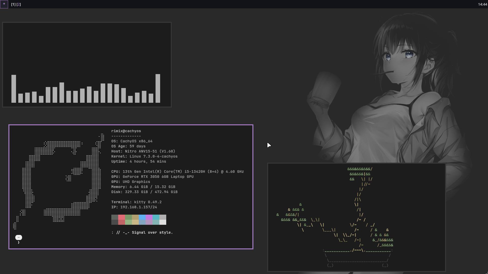

# dots

Minimal black-gray rice on **Hyprland** with one accent color — purple `#9f78bd`.
Gray interface, while everything that renders content (icons, terminal highlighting, images) stays colorful.



## What's inside

| Folder | What it configures |
|---|---|
| `hypr` | Hyprland (Lua config split into modules), hyprpaper, hyprlock, hypridle |
| `kitty` | terminal: font, colors, cursor trail |
| `fuzzel` | launcher |
| `quickshell` | `shell.qml` |
| `qt` | `kdeglobals` and qt6ct: Qt application colors |
| `fastfetch` | config and logo |
| `starship` | prompt |
| `swaync` | notification center: config and style |
| `swayosd` | on-screen indicators for volume/brightness: config and style |
| `system` | files outside `~`: `etc/ly/config.ini` for the ly display manager |
| `nvim` | editor |

The Hyprland config is written in Lua (Hyprland 0.55+ format) and split into files:
`hyprland.lua` pulls in `appearance`, `input`, `binds`, `rules`, and `autostart`.

## Palette

| Role | Color |
|---|---|
| background | `#1c1c1c` |
| inactive border | `#333333` |
| text | `#d0d0d0` |
| accent (active border, selection, cursor) | `#9f78bd` |

One font everywhere: JetBrainsMono Nerd Font. Cursor: Bibata-Modern-Ice. Icons: Papirus-Dark.

## Keybinds

| Keys | Action |
|---|---|
| `SUPER + Q` | terminal (kitty) |
| `SUPER + R` | launcher (fuzzel) |
| `SUPER + C` | close window |
| `SUPER + V` | toggle floating window |
| `SUPER + J` | toggle split direction |
| `SUPER + F` | fullscreen |
| `SUPER + D` | maximize with borders and gaps |
| `SUPER + L` | lock screen (hyprlock) |
| `SUPER + 1…0` | workspace |
| `SUPER + SHIFT + 1…0` | move window to workspace |
| `Print` | screenshot area to clipboard |

## Dependencies

Arch Linux (package names may differ on other distributions):

```
hyprland hyprpaper hyprlock hypridle kitty fuzzel fastfetch starship quickshell
stow grim slurp hyprshot wl-clipboard cliphist brightnessctl playerctl
plasma-integration qt6ct
ttf-jetbrains-mono-nerd papirus-icon-theme bibata-cursor-theme
swaync swayosd
```

Display manager: `ly` (optional).

## Installation

```
git clone https://github.com/Rimix98/dots ~/dots
cd ~/dots
```

If `~/.config` already contains files with the same names, `stow` refuses to replace them: back them up or remove them first.

```
stow hypr kitty fuzzel quickshell qt fastfetch starship swaync swayosd
```

Configs with absolute paths (wallpapers and the Qt scheme) use the `/home/USER` placeholder.
Substitute your home directory:

```
sed -i "s|/home/USER|$HOME|g" ~/.config/hypr/hyprpaper.conf ~/.config/hypr/hyprpaper.lua ~/.config/hypr/hyprlock.conf ~/.config/hypr/autostart.lua ~/.config/qt6ct/qt6ct.conf ~/.config/swayosd/config.toml
```

Place the wallpaper at `~/Изображения/Wallpapers/Wallpaper.png` (or fix the path in `hyprpaper.conf`, `hyprpaper.lua` and `hyprlock.conf`).

Display manager ly (optional):

```
sudo cp system/etc/ly/config.ini /etc/ly/config.ini
```

Performance and shutdown fixes (optional):

```
sudo cp system/etc/modprobe.d/nvidia-performance.conf /etc/modprobe.d/
sudo cp system/etc/systemd/system/i915-minfreq.service /etc/systemd/system/
for m in tmp var-cache var-tmp; do
  sudo mkdir -p /etc/systemd/system/$m.mount.d
  sudo cp system/etc/systemd/system/$m.mount.d/timeout.conf /etc/systemd/system/$m.mount.d/
done
sudo systemctl daemon-reload
sudo systemctl enable --now i915-minfreq.service
sudo reboot
```

- `nvidia-performance.conf` disables dGPU runtime power management (fixes Xid 79
  "GPU has fallen off the bus" on this laptop; costs some idle battery).
- `i915-minfreq.service` keeps the Intel GPU at ≥400 MHz (fixes cursor stutter
  at the 100 MHz floor). Check with `cat /sys/class/drm/card*/gt_min_freq_mhz`.
- the mount drop-ins cap unmount time at 30 s so poweroff cannot hang on busy
  `/tmp`, `/var/cache` or `/var/tmp`.

## Notes

- Qt applications take colors from `~/.config/kdeglobals` through the `kde` plugin
  (`QT_QPA_PLATFORMTHEME=kde`), not through qt6ct.
- `autostart.lua` starts hyprpaper and `wl-paste --watch cliphist store`:
  remove or adjust to your needs.
- Back up your own configs before applying these.

## Wallpaper

`hyprpaper` uses `Изображения/Wallpapers/Wallpaper.png`, `hyprlock` references
[wallhaven-1kld7w](https://wallhaven.cc/w/1kld7w). The image rights belong to
their authors, so neither file is included in the repository — put your own
images at those paths (or fix the paths).
